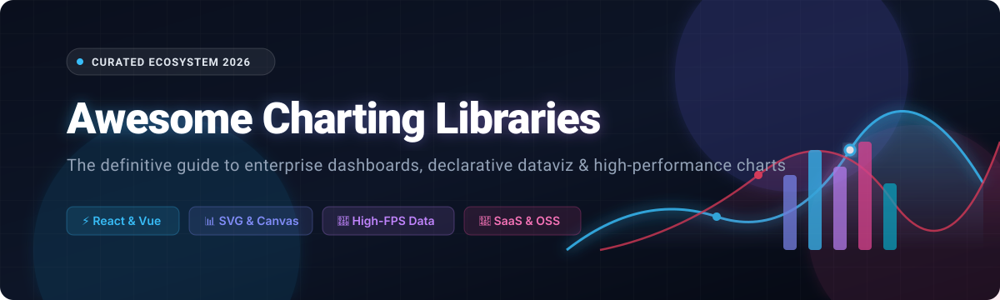

# 📊 Awesome Charting Libraries

### 🚀 A Curated List of Premier SaaS Platforms & Open-Source Data Visualization Toolkits

  <em>High-performance charting, declarative visualization components, composable primitives, and interactive dashboard SDKs.</em>

<!-- Badges Header -->

  
  
  
  
  
  

  <strong>Updated: October 2026</strong> • <strong>Curated by <a href="https://github.com/ishandutta2007">@ishandutta2007</a></strong>

---

## 🧭 Overview & Ecosystem Architecture

Welcome to **Awesome Charting Libraries** — the comprehensive, developer-first catalog of commercial SaaS solutions and cutting-edge open-source visualization projects. Whether you are engineering real-time financial telemetry dashboards, scientific exploratory canvases, or reactive UI admin suites (React, Vue, Svelte, Angular, Vanilla JS), this guide breaks down trade-offs between **declarative abstraction**, **SVG vs. Canvas rendering**, and **runtime throughput**.

### 🌟 Quick Navigation
- [📈 Sector Overview & Market Dynamics](#-sector-overview--market-dynamics)
- [🏢 SaaS & Hosted Commercial Platforms](#-saas--hosted-commercial-platforms)
- [🔓 Open-Source GitHub Projects (Ranked by Stars)](#-open-source-github-projects-ranked-by-stars)
  - [👑 Top Tier Libraries](#-top-tier-libraries)
  - [🚀 Specialized & Modern Frameworks](#-specialized--modern-frameworks)
- [🤝 How to Contribute](#-how-to-contribute)
- [☕ Support & Sponsorship](#-support--sponsorship)
- [📜 Star History](#-star-history)
- [⚠️ Disclaimer](#-disclaimer)

---

## 📈 Sector Overview & Market Dynamics

The global data visualization and charting software market is estimated at approximately **$10.9B to $13.4B in 2024–2026**, expanding at a compound annual growth rate (CAGR) of ~11–14% toward over **$25B by the early 2030s**. 

The sector exhibits **moderate concentration**:
- **Enterprise BI Dominance**: Heavyweight enterprise BI platforms (Microsoft Power BI, Salesforce Tableau, Google Looker) control centralized reporting and corporate analytics budgets.
- **Embedded & Developer SDK Fragmentation**: The developer-facing charting ecosystem is highly fragmented. Engineering teams increasingly demand embeddable, customizable SDKs with sub-millisecond redraws, zero licensing friction, and native integration into modern frontend toolchains (React, Vue, Svelte, TypeScript).

---

## 🏢 SaaS & Hosted Commercial Platforms

Commercial platforms provide ready-to-use cloud infrastructure, specialized financial or geospatial charting engines, enterprise accessibility (ADA/Section 508), and dedicated SLAs.

*Sorted descending by estimated corporate scale and revenue:*

| Platform | Revenue / Valuation (Est.) | Starting Price | Free Tier / Trial Limits | Description |
| :--- | :--- | :--- | :--- | :--- |
| **[Plotly Cloud](https://plotly.com/)** | ~$18M–$50M ARR / ~$14M funding | $29/creator seat/month | Free forever: 1 concurrent running app (public/personal share), community support, and trial AI credits | The commercial platform behind Plotly.js & Dash; offers cloud app hosting, Studio, and Dash Enterprise for private/on-prem deployments. |
| **[Highcharts](https://www.highcharts.com/)** | ~$6.5M–$10M ARR | $185/developer/year | Free for non-commercial use only (personal sites, student coursework, non-profit); commercial/internal/SaaS usage strictly requires paid license | Mature commercial charting library featuring 30+ chart types, maps, Gantt, stock charts, and deep accessibility compliance. |
| **[FusionCharts](https://www.fusioncharts.com/)** | ~$5M+ ARR (Acquired by Idera) | $439/developer/year | 14-day free trial with unrestricted access to all 100+ chart types and map features | Enterprise charting suite providing 100+ chart types, gauges, maps, real-time streaming, and cross-framework support. |
| **[amCharts](https://www.amcharts.com/)** | <$5M ARR | $80/developer/year | Free forever: full access to all chart types and features, but displays a permanent "amCharts" branding link/watermark | High-performance charting and geospatial mapping library with comprehensive stock, financial, and geographic visualization tools. |
| **[AnyChart](https://www.anychart.com/)** | Small/Mid Enterprise (<$5M ARR) | $49/website (one-time) | Free forever for non-profit/educational use; unlimited-time free evaluation with visible watermark on charts | Enterprise visualization engine with 70+ chart types, Gantt charts, maps, and stock charts across JavaScript frameworks. |
| **[ZingChart](https://www.zingchart.com/)** | ~$300k–$500k ARR | $249 (one-time license) | Free forever (Branded License): full access to all chart modules and unlimited rendering, but requires a visible "Powered by ZingChart" watermark (hidden on `localhost`) | Fast canvas/SVG hybrid charting library designed for high-density datasets, real-time telemetry, and modular dashboards. |

---

## 🔓 Open-Source GitHub Projects (Ranked by Stars)

All open-source repositories are strictly ranked in descending order by community GitHub Stars_Count. Each entry features a live GitHub Stars_Badge linking directly to the project's stargazers page.

### 👑 Top Tier Libraries

- **[D3.js](https://github.com/d3/d3)**   
  **The foundational JavaScript library for manipulating documents based on data** (ISC).  
  *Toolkit primitives*: Low-level DOM binding, scales, shapes, and physics layouts. Everything in the modern JavaScript visualization world is either built on D3 or heavily influenced by its mathematical foundations. Steep learning curve with total artistic and technical control.  
  🎯 **Best for**: Bespoke interactive graphics, custom infovis research, and novel visualization algorithms.

- **[Chart.js](https://github.com/chartjs/Chart.js)**   
  **Simple, clean, and engaging HTML5 canvas charts for designers & developers** (MIT).  
  *HTML5 Canvas*: Provides 8 core chart types with built-in spring animations, tooltips, responsive canvas wrappers, and extensive community plugin extensions.  
  🎯 **Best for**: Standard web applications, client admin panels, and rapid dashboard prototypes.

- **[Apache ECharts](https://github.com/apache/echarts)**   
  **Powerful enterprise-grade charting and visualization library** (Apache-2.0).  
  *Canvas/SVG + WebGL*: Supports 20+ chart families, 3D surface charts (GL), coordinate systems, maps, heatmaps, and dynamic streaming zoom.  
  🎯 **Best for**: Heavy enterprise reporting suites, high-density telemetry, and complex multi-coordinate dashboards.

- **[Recharts](https://github.com/recharts/recharts)**   
  **Redefined React-native charting library built with React & D3** (MIT).  
  *Declarative React Components*: Write charts with native JSX tags (`<ResponsiveContainer>`, `<LineChart>`, `<Bar>`, `<Tooltip>`). Pure SVG rendering.  
  🎯 **Best for**: Modern React/Next.js applications prioritizing DX and declarative component composition.

- **[Visx (Airbnb)](https://github.com/airbnb/visx)**   
  **A collection of expressive, low-level visualization primitives for React** (MIT).  
  *Unopinionated Primitives*: Splits D3 math into modular React components (scale, axis, shape, grid, clip-path) without dictating a rigid chart model or bloating bundle size.  
  🎯 **Best for**: Design systems, custom React visualization components, and modular chart architectures.

- **[Plotly.js](https://github.com/plotly/plotly.js)**   
  **The high-level scientific and statistical JavaScript charting library** (MIT).  
  *Scientific & Financial*: Built-in support for 40+ chart archetypes, statistical distributions, contour plots, ternary diagrams, and 3D WebGL charts. Powers Plotly.py and Dash.  
  🎯 **Best for**: Data science portals, academic research, finance, and engineering applications.

- **[Lightweight Charts (TradingView)](https://github.com/tradingview/lightweight-charts)**   
  **High-performance financial and trading canvas charts by TradingView** (Apache-2.0).  
  *Hyper-optimized HTML5 Canvas*: Zero-dependency, lightweight footprint (~45 KB) specifically crafted for candlesticks, volume bars, trendlines, and realtime trading feeds.  
  🎯 **Best for**: Crypto exchanges, fintech apps, brokerage dashboards, and stock trackers.

- **[ApexCharts.js](https://github.com/apexcharts/apexcharts.js)**   
  **Modern, interactive SVG charts with sleek animations and multi-framework wrappers** (MIT).  
  *Polished Out of the Box*: First-class wrappers for React, Vue, Svelte, and Angular. Packed with smooth animations, heatmaps, mixed timelines, and auto-generated legends.  
  🎯 **Best for**: SaaS product dashboards, modern consumer apps, and marketing analytics.

- **[Frappe Charts](https://github.com/frappe/charts)**   
  **Simple, responsive, zero-dependency SVG charts inspired by GitHub contributions** (MIT).  
  *Zero Dependencies*: Featherweight footprint (~15 KB) generating clean SVG bar, line, scatter, and heatmap visuals.  
  🎯 **Best for**: Lightweight embeds, static sites, GitHub-style heatmaps, and low-complexity web apps.

- **[Deck.gl (Uber)](https://github.com/uber/deck.gl)**   
  **WebGL2-powered framework for large-scale data and geospatial exploratory visualization** (MIT).  
  *GPU Accelerated*: Renders millions of spatial points, 3D buildings, hexbins, and trajectories at 60 FPS directly on the GPU. Integrates seamlessly with Mapbox and MapLibre.  
  🎯 **Best for**: Big data geospatial intelligence, logistics mapping, and GPU-driven rendering.

- **[Nivo](https://github.com/plouc/nivo)**   
  **Rich suite of aesthetic data visualization components built on React & D3** (MIT).  
  *Design-First*: Offers 40+ chart archetypes (Chord, Sankey, Treemap, Sunburst, Bump, Calendar). Provides Canvas, SVG, HTML rendering, and full Server-Side Rendering (SSR) support.  
  🎯 **Best for**: Executive dashboards, editorial graphics, and modern React applications demanding top-tier typography and aesthetics.

- **[Chartist.js](https://github.com/chartist-js/chartist)**   
  **Simple, responsive SVG charting library with CSS styling architecture** (MIT).  
  *CSS Separation*: Chart geometry is SVG while all visual aesthetics (colors, strokes, fills, animations) are driven cleanly via standard CSS classes.  
  🎯 **Best for**: CSS-centric styling pipelines, design systems, and responsive frontends.

- **[AntV G2](https://github.com/antvis/G2)**   
  **The grammar of interactive graphics by Ant Group** (MIT).  
  *Grammar of Graphics*: Deep declarative visual encoding inspired by Leland Wilkinson's Grammar of Graphics. Comprehensive ecosystem with automated chart layout and smart tooltips.  
  🎯 **Best for**: Comprehensive data visualization platforms and analytical systems.

- **[Vega](https://github.com/vega/vega)**   
  **Declarative visualization grammar for creating, saving, and sharing interactive visual designs** (BSD-3-Clause).  
  *JSON Specification*: Define visual appearances and interactive behaviors in clean JSON specifications; compiles into SVG or Canvas using D3 math.  
  🎯 **Best for**: Visual analytics platforms, data journalism, and automated chart generation systems.

- **[Victory](https://github.com/FormidableLabs/victory)**   
  **Composable React and React Native components for building data visualizations** (MIT).  
  *Cross-Platform*: Identical API schema across React web and React Native mobile apps. Highly modular component blocks.  
  🎯 **Best for**: Universal codebases across iOS, Android, and web.

- **[uPlot](https://github.com/leeoniya/uPlot)**   
  **Fast, memory-efficient 2D canvas chart for time-series, lines, areas, OHLC & bars** (MIT).  
  *Maximum Throughput*: Extremely fast rendering engine capable of plotting 150,000 data points in ~25ms at a tiny ~35 KB footprint.  
  🎯 **Best for**: IoT metrics, real-time server monitoring, live sensor data, and high-frequency time-series.

---

### 🚀 Specialized & Modern Frameworks

- **[C3.js](https://github.com/c3js/c3)**   
  **D3-based reusable chart library** (MIT). Wraps D3 boilerplate into simple object-driven APIs.

- **[Charts.css](https://github.com/chartscss/charts.css)**   
  **Pure CSS data visualization framework** (MIT). Uses semantic HTML tags (`<table>`) and transforms them into interactive bar, column, and area charts without JavaScript.

- **[3D Force-Graph](https://github.com/vasturiano/3d-force-graph)**   
  **3D force-directed graph component using Three.js and WebGL** (MIT). Renders complex network topologies, relational data, and knowledge graphs in 3D space.

- **[Billboard.js (NAVER)](https://github.com/naver/billboard.js)**   
  **Re-usable, modern D3-based JavaScript chart library** (MIT). The official modern fork and actively maintained successor to C3.js supporting latest D3 versions.

- **[Vega-Lite](https://github.com/vega/vega-lite)**   
  **High-level grammar of interactive graphics** (BSD-3-Clause). Concise JSON syntax generating full Vega specifications for exploratory analysis and multi-view interactive dashboards.

- **[Observable Plot](https://github.com/observablehq/plot)**   
  **Concise API for exploratory data visualization by Observable** (ISC). Created by Mike Bostock; provides declarative marks, transforms, and automatic scales for rapid exploratory analysis.

- **[Tremor](https://github.com/tremorlabs/tremor)**   
  **Modern React components for building dashboards and analytics UIs** (Apache-2.0). Opinionated Tailwind CSS + Recharts visual building blocks for fast admin panels.

- **[Unovis (F5)](https://github.com/f5/unovis)**   
  **Modular data visualization framework with multi-framework bindings** (Apache-2.0). Native integration across React, Angular, Svelte, Vue, and vanilla JavaScript.

- **[RoughViz](https://github.com/rough-stuff/rough-viz)**   
  **Sketchy / hand-drawn styled charting library based on D3 and Rough.js** (MIT). Delivers charming hand-drawn aesthetics for presentations, rough prototypes, and storyboards.

---

## 🛠️ Selection Guide: Architectural Comparison

| Library | Primary Target | Rendering | Bundle Weight | Abstraction Level |
| :--- | :--- | :--- | :--- | :--- |
| **D3.js** | Any Web Project | SVG / Canvas / HTML | Modular (~80 KB) | Low (Primitive Toolkit) |
| **Chart.js** | Generic Web | HTML5 Canvas | Light (~65 KB) | High (Config Driven) |
| **Apache ECharts** | Enterprise Dashboards | Canvas / SVG / WebGL | Comprehensive (~300 KB+) | High (Feature Rich) |
| **Recharts** | React Apps | SVG | Medium (~100 KB) | High (Declarative JSX) |
| **Visx** | React Design Systems | SVG | Highly Modular (Pick & Choose) | Medium (React Primitives) |
| **Lightweight Charts**| Financial / Trading | HTML5 Canvas | Tiny (~45 KB) | High (Domain Specific) |
| **uPlot** | Real-time & IoT | HTML5 Canvas | Ultralight (~35 KB) | Low/Medium (High Speed) |
| **Deck.gl** | Geospatial / 3D | WebGL2 / GPU | Heavy (Big Data Focused) | Medium (GPU Layers) |

---

## 🤝 How to Contribute

Contributions make the open-source and data visualization community thrive! To add or update an entry:

1. **Fork the repository** 🍴
2. **Create a branch**: `git checkout -b feature/add-library-name`
3. **Follow the formatting**:
   - Provide the official URL, repository link, and license.
   - Add accurate pricing information (starting tier) and free tier/trial limits for SaaS products.
   - For open-source libraries, ensure the GitHub Stars_Badge (`style=social&color=white`) links to the repo's stargazers page.
4. **Open a Pull Request** with a brief summary of the project's differentiators.

---

## ☕ Support & Sponsorship

If this curated visualization collection has helped you save time, architect a dashboard, or discover the perfect charting library for your stack, consider supporting its ongoing maintenance and research!

- ⭐ **Star this repository** to help others discover it.
- 🍴 **Fork and share** with your engineering and data teams.
- ☕ **Buy me a coffee & sponsor my open-source work**:  
  👉 **[Support on GitHub Sponsors](https://github.com/sponsors/ishandutta2007)** 💖

Thank you to all contributors, sponsors, and visualization enthusiasts who keep this ecosystem vibrant! 🙌

---

## 📜 Star History

---

## ⚠️ Disclaimer

- This list is community-curated for informational, benchmarking, and educational purposes. Inclusion does not imply official commercial endorsement.
- Verify all current software licensing terms before bundling libraries into proprietary or SaaS applications (e.g., dual commercial licenses on Highcharts or attribution requirements on amCharts).
- All brand names, logos, and trademarks remain the property of their respective owners.

---

  Built with ❤️ by <a href="https://github.com/ishandutta2007">Ishan Dutta</a> and the global open-source community.

